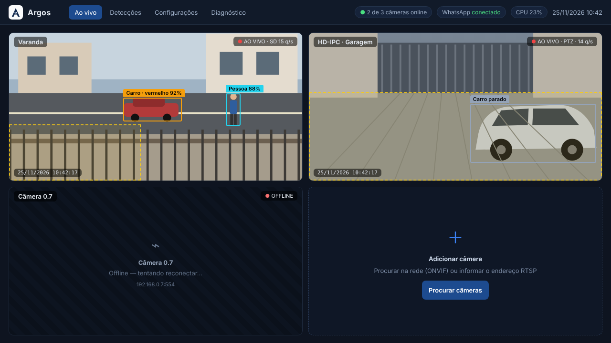
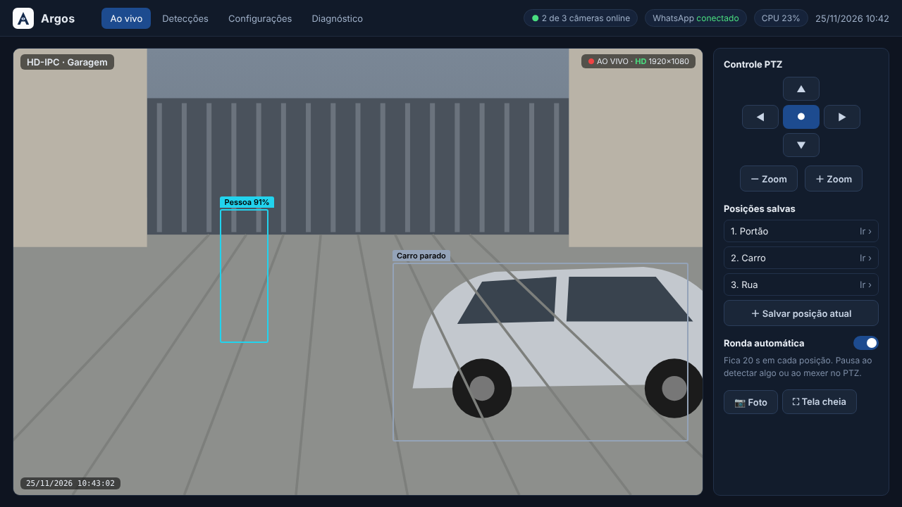
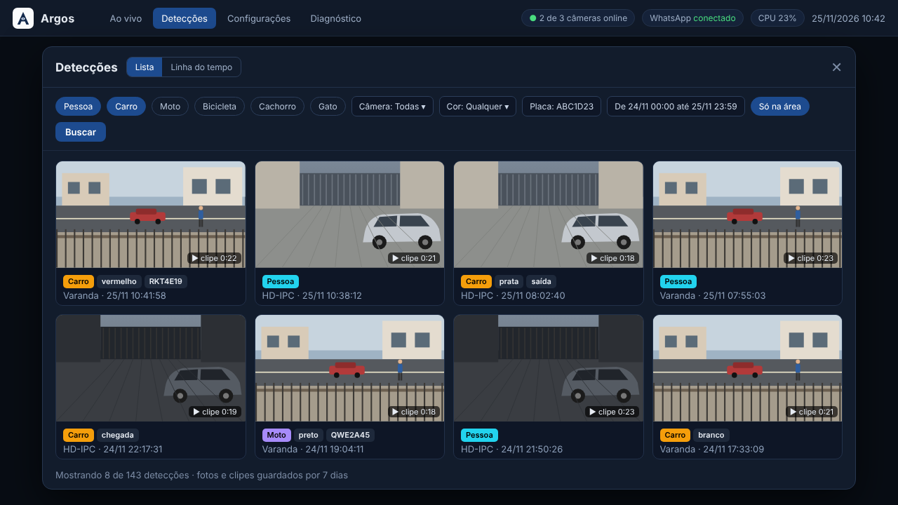
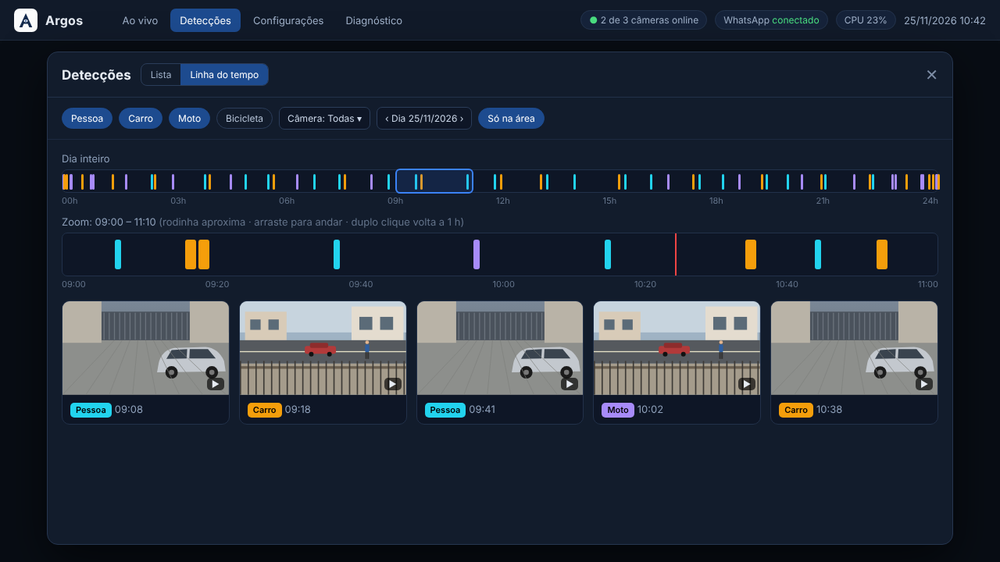
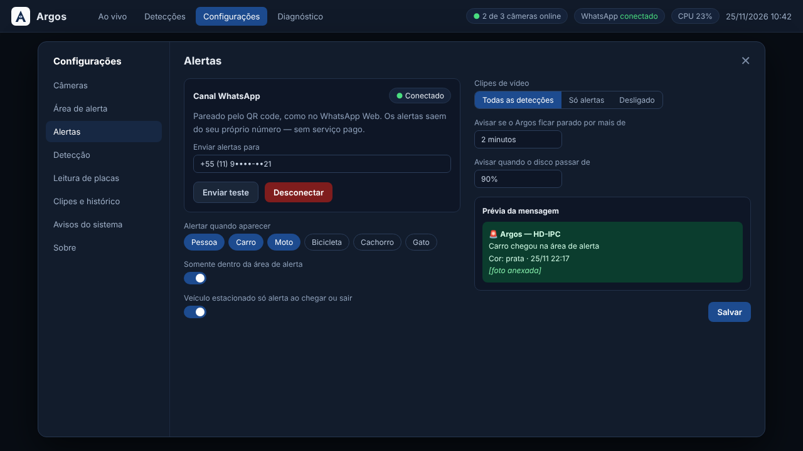
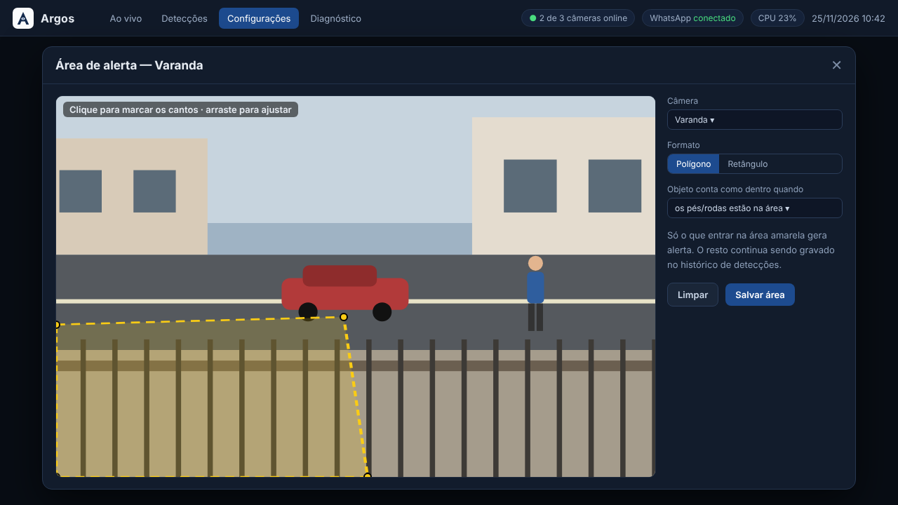
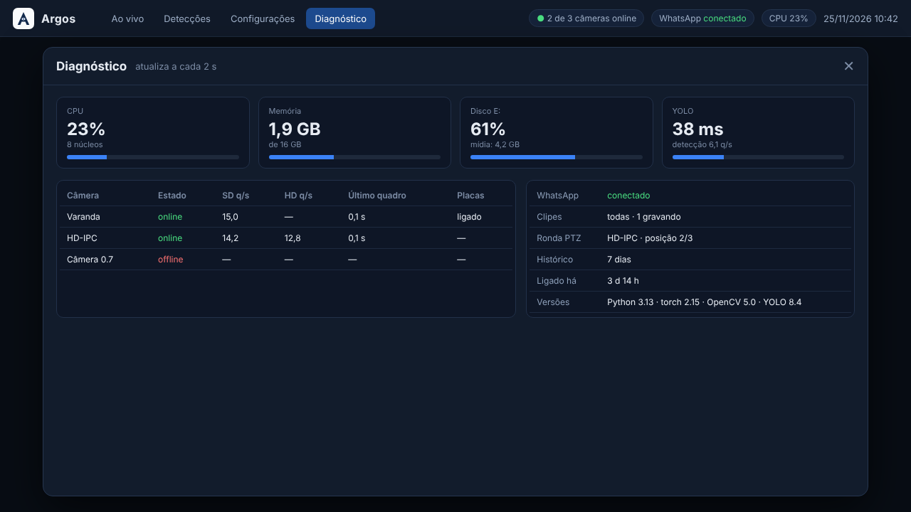
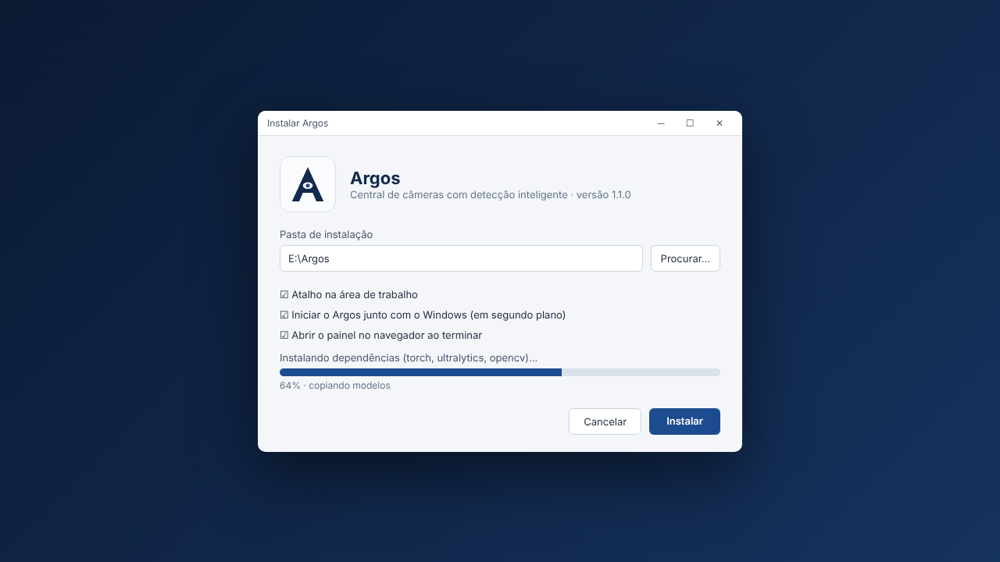
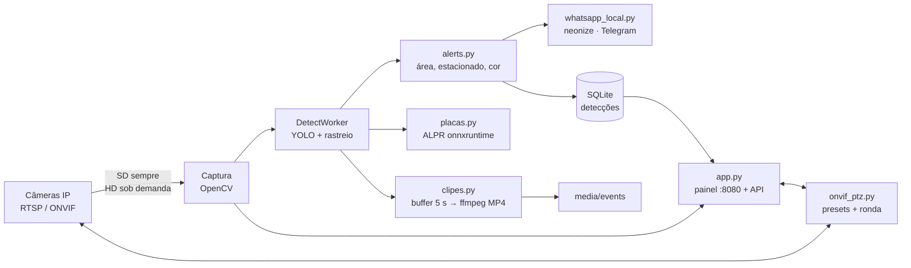

<div align="center">


# Argos

**Central de câmeras com detecção inteligente, para rodar no seu próprio PC**

Veja suas câmeras IP ao vivo, receba alertas no WhatsApp quando uma pessoa ou um veículo entrar na área que você escolheu e encontre qualquer acontecimento com foto e clipe de vídeo. Tudo local: sem nuvem e sem mensalidade.


[Telas](#-telas) · [Funcionalidades](#-funcionalidades) · [Instalação](#-instalação) · [Como funciona](#-como-funciona) · [API](#-api) · [Problemas comuns](#-problemas-comuns)

</div>

---

## 📸 Telas

<table>
  <tr>
    <td width="50%" align="center"><br><b>Ao vivo</b><br><sub>Grade de câmeras com caixas de detecção e área de alerta</sub></td>
    <td width="50%" align="center"><br><b>Câmera em HD + PTZ</b><br><sub>Controle de direção e zoom, posições salvas e ronda</sub></td>
  </tr>
  <tr>
    <td width="50%" align="center"><br><b>Detecções: lista</b><br><sub>Busca por tipo, câmera, cor, placa e período</sub></td>
    <td width="50%" align="center"><br><b>Detecções: linha do tempo</b><br><sub>O dia inteiro numa barra, com zoom de 20 s até 24 h</sub></td>
  </tr>
  <tr>
    <td width="50%" align="center"><br><b>Alertas</b><br><sub>WhatsApp pareado por QR code, tipos de objeto e avisos do sistema</sub></td>
    <td width="50%" align="center"><br><b>Área de alerta</b><br><sub>Desenhe na imagem a região que deve gerar alerta</sub></td>
  </tr>
  <tr>
    <td width="50%" align="center"><br><b>Diagnóstico</b><br><sub>CPU, memória, disco, quadros por segundo e estado de cada serviço</sub></td>
    <td width="50%" align="center"><br><b>Instalador</b><br><sub>Instala, repara, reinstala e desinstala</sub></td>
  </tr>
</table>

> Todas as imagens têm 1280×720 px, então ficam do mesmo tamanho e alinhadas na tabela.

---

## ✨ Funcionalidades

### 🎥 Câmeras
- **Câmeras IP por RTSP**, com busca automática na rede (ONVIF) e teste das senhas de fábrica mais comuns. Também dá para informar a senha à mão.
- **Dois fluxos por câmera:** o SD (leve) fica sempre ligado para a grade e para a detecção, e o **HD** só liga quando você abre a câmera (ou quando a leitura de placas precisa dele). Enquanto o HD não chega, a tela continua mostrando o SD.
- **PTZ via ONVIF:** mover, dar zoom, salvar e apagar posições (presets) com nome, e fazer uma **ronda automática** entre elas. A ronda pausa por 15 s quando algo é detectado e por 60 s quando alguém mexe no PTZ.
- A grade pausa sozinha quando a aba do navegador fica escondida, para economizar CPU.

### 🧠 Detecção
- **YOLO (Ultralytics)** reconhece pessoa, carro, moto, bicicleta, cachorro, gato e outros. Só roda quando há movimento ou a cada 0,5 s.
- **Área de alerta** por câmera: só o que entra nela gera alerta. O resto vai apenas para o histórico.
- **Veículo estacionado não alerta.** Um carro parado por 20 s vira "Carro parado" (em cinza), e a vaga fica memorizada. O alerta só sai quando ele **chega** ou **sai** (a caixa precisa se deslocar de verdade em 3 leituras seguidas). Uma pessoa passando na frente ou uma detecção que "pisca" não geram alerta.
- Proteções contra **alerta falso causado por farol à noite**.
- **Cor dominante** do objeto (desligada à noite, quando a imagem fica em preto e branco).
- **Leitura de placas (ALPR)** no padrão brasileiro, com `onnxruntime`. Liga por câmera. Os modelos (cerca de 11 MB) são baixados na primeira vez para `modelos/`.

### 🔔 Alertas
- **WhatsApp local** (biblioteca `neonize`): você pareia pelo QR code, como no WhatsApp Web, e os alertas saem do seu próprio número. Não precisa de serviço pago nem de API de terceiros.
- **Telegram** como canal alternativo: crie um bot com o `@BotFather` e cole o token nas configurações.
- Pode enviar para o mesmo número que envia: a mensagem chega em "Mensagem para mim", só que sem notificação.
- **Avisos do sistema:** se o Argos ficou parado por mais de 2 min, avisa "ficou parado das X às Y" quando volta. Também avisa quando o disco passa de 90%.

### 🗂️ Histórico
- **Detecções** com foto (quadro inteiro da câmera) e **clipe de vídeo**.
- **Clipes:** o Argos guarda sempre os últimos 5 s em memória. Quando algo é detectado, grava o vídeo a partir de 5 s antes e até 10 s depois da última detecção (no máximo 60 s). O arquivo é **MP4 fragmentado**, então dá para assistir enquanto ainda está gravando. Modos: *todas as detecções*, *só alertas* ou *desligado*.
- **Busca** por vários tipos ao mesmo tempo, câmera, cor, placa, período e "só na área".
- **Linha do tempo:** uma barra com o dia inteiro e outra com zoom. A rodinha do mouse aproxima (de 20 s até 24 h), arrastar faz andar, Shift + rodinha também anda e o duplo clique volta para 1 h.
- Retenção configurável (padrão: **7 dias**).

### 🛠️ Sistema
- Painel web em `http://localhost:8080`, acessível de qualquer aparelho da rede local.
- **Senha de acesso opcional** para quem entra de outro aparelho da rede (`server.password` no `cameras.json` ou a variável `ARGOS_PASSWORD`). No próprio PC a senha não é pedida. Pedidos vindos de outros sites são bloqueados.
- **Estatísticas e mapa de calor** dos movimentos de cada câmera.
- Ícone na bandeja do Windows, ao lado do relógio, com a opção **Reiniciar**.
- Tela de **Diagnóstico** com CPU, memória, disco, tamanho da mídia, quadros por segundo de cada câmera (SD/HD), idade do último quadro, tempo do YOLO e estado da ronda, das placas, dos clipes e do WhatsApp, além das versões instaladas.
- Desliga o modo de economia de energia do Windows (EcoQoS) no próprio processo, para não ficar lento em segundo plano.
- **Instalador** gráfico com Reparar, Reinstalar e Desinstalar.

---

## 💻 Requisitos

| Item | Mínimo recomendado |
|---|---|
| Sistema | Windows 10 ou 11 (64 bits) |
| Python | 3.13 (só para instalação manual; o instalador já cuida disso) |
| CPU | 4 núcleos (o YOLO roda na CPU, não precisa de placa de vídeo) |
| Memória | 8 GB |
| Disco | Alguns GB livres para fotos e clipes (depende de quantas câmeras e de quantos dias guardar) |
| Câmeras | Câmeras IP com RTSP; PTZ e busca automática exigem ONVIF |

---

## 🚀 Instalação

### Opção 1: instalador (recomendado)

1. Baixe o **`Instalar Argos.exe`** na página de [Releases](https://github.com/LucaRenaultLamas/Argos/releases/latest).
2. Escolha a pasta (por exemplo, `E:\Argos`) e as opções:
   - atalho na área de trabalho;
   - iniciar junto com o Windows (em segundo plano, com `--fundo`).
3. Ao terminar, o painel abre em **http://localhost:8080**.

O instalador cria atalhos no menu Iniciar (**Argos**, **Reparar Argos** e **Desinstalar Argos**) e registra o programa em *Aplicativos instalados* do Windows. Se você abrir o instalador com o Argos já instalado, ele mostra as opções **Reparar**, **Reinstalar** e **Desinstalar**. Ao desinstalar, dá para manter as câmeras (`cameras.json`) e o histórico (`media/`).

### Opção 2: manual (a partir do código)

```bat
git clone https://github.com/LucaRenaultLamas/Argos.git
cd Argos
py -3.13 -m venv .venv
.venv\Scripts\python.exe -m pip install -r requirements.txt
copy cameras.exemplo.json cameras.json
iniciar.bat
```

O `iniciar.bat` usa o Python do `.venv` e só roda o `pip install` de novo quando o `requirements.txt` muda (ele compara com `.venv\requirements.instalado`).

### Gerar o instalador

```bat
cd instalador
gerar-instalador.bat
```

Isso usa o PyInstaller e cria, em `instalador\dist\`:
- `Instalar Argos.exe`, com o pacote (`payload.zip`) montado a partir da pasta do Argos;
- `Desinstalar Argos.exe`, que vai dentro do pacote.

---

## 🧭 Primeiros passos

1. **Adicione as câmeras:** em *Ao vivo*, clique em **Adicionar câmera → Procurar câmeras**. O Argos procura por ONVIF e testa as senhas de fábrica. Se a sua câmera tiver outra senha, digite-a no campo manual.
2. **Desenhe a área de alerta:** em *Configurações → Área de alerta*, marque na imagem a região que importa (portão, garagem, calçada…).
3. **Conecte o WhatsApp:** em *Configurações → Alertas → Canal WhatsApp*, leia o QR code com o celular (*Aparelhos conectados*) e use **Enviar teste**.
4. *(Opcional)* Ligue a **leitura de placas** nas câmeras que filmam veículos de perto.
5. *(Opcional)* Em câmeras PTZ, salve as **posições** e ligue a **ronda**.

---

## ⚙️ Como funciona



| Módulo | O que faz |
|---|---|
| `app.py` | Servidor web (painel e API), captura das câmeras, `DetectWorker` (YOLO, rastreio de objetos, vagas de veículos estacionados), stream MJPEG e diagnóstico |
| `alerts.py` | Decide o que vira alerta (área, movimento real de veículo, tipos escolhidos), calcula a cor dominante e cuida dos avisos do sistema (`SystemWatch`) |
| `clipes.py` | `ClipManager`: buffer de 5 s por câmera e gravação dos clipes com ffmpeg (libx264, MP4 fragmentado) |
| `placas.py` | Leitura de placas no padrão brasileiro com `onnxruntime` |
| `onvif_ptz.py` | Comandos PTZ, presets e ronda via ONVIF |
| `whatsapp_local.py` | Sessão do WhatsApp (QR code) e envio de mensagens com foto |
| `scanner.py` | Varredura da rede para encontrar câmeras |
| `static/index.html` | Painel web |
| `instalador/` | Instalador e desinstalador (tkinter + PyInstaller) |

---

## 📁 Estrutura de pastas

```
Argos/
├── app.py                 # servidor, captura, detecção e API
├── alerts.py              # regras de alerta e avisos do sistema
├── clipes.py              # gravação de clipes
├── placas.py              # leitura de placas
├── onvif_ptz.py           # PTZ / presets / ronda
├── whatsapp_local.py      # alertas por WhatsApp
├── scanner.py             # procura câmeras na rede
├── yolov8n.pt             # modelo YOLO
├── Argos.exe              # ícone na bandeja do Windows
├── cameras.exemplo.json   # modelo de configuração (sem câmeras)
├── static/index.html      # painel web
├── icone/                 # argos.svg, argos.ico, argos-256.png, argos-512.png
├── instalador/            # argos_instalador.py, gerar_instalador.py, gerar-instalador.bat
├── iniciar.bat            # abre o servidor (janela "Argos - servidor")
├── reiniciar.bat          # fecha só a janela do servidor e abre de novo
├── requirements.txt
├── cameras.json           # suas câmeras e configurações   (não versionar)
├── modelos/               # modelos de placas, baixados     (não versionar)
└── media/                 # fotos, clipes, banco, sessão    (não versionar)
    ├── events/<dia>/<cam>_<hora>_clipe.mp4
    ├── whatsapp_sessao.sqlite3
    └── batimento.json
```

> ⚠️ **Não suba para o GitHub** o `cameras.json` (tem usuário e senha das câmeras), a pasta `media/` (imagens da sua casa e a sessão do WhatsApp) nem a pasta `modelos/`. O `.gitignore` deste repositório já exclui esses arquivos.

---

## 🔌 API

O painel usa uma API HTTP em `http://localhost:8080/api`. Principais rotas:

| Método | Rota | Descrição |
|---|---|---|
| `GET` `POST` | `/api/settings` | Lê e altera as configurações (ex.: `keep_days`, `clips_mode`, `sys_down_minutes`, `disk_percent`) |
| `GET` | `/api/scan` | Procura câmeras na rede e testa as senhas de fábrica |
| `POST` | `/api/scan/senha` | Testa uma senha informada à mão |
| `GET` | `/api/timeline?cam=<id>\|*` | Detecções do dia para a linha do tempo (`*` = todas as câmeras) |
| `GET` | `/api/diag` | Diagnóstico completo (CPU, memória, disco, q/s, YOLO, serviços, versões) |
| `GET` | `/api/ptz/<cam>/presets` | Lista as posições salvas (também salva, vai até e apaga) |
| `POST` | `/api/ptz/<cam>/patrol` | Liga/desliga a ronda e define o tempo em cada posição |

A busca de detecções aceita vários tipos (`label=Carro,Moto`), `color` e `plate`. Sem data, a busca cobre os últimos 7 dias.

---

## 🧩 Configurações principais

| Chave | Padrão | Significado |
|---|---|---|
| `keep_days` | `7` | Dias que fotos e clipes ficam guardados |
| `clips_mode` | `todas` | `todas`, `alertas` ou `desligado` |
| `sys_down_minutes` | `2` | Avisa se o Argos ficou parado por mais que isso |
| `disk_percent` | `90` | Avisa quando o disco passa desse uso |
| `plates` (por câmera) | `false` | Liga a leitura de placas (mantém o HD ligado) |
| `patrol` (por câmera) | desligada | `{enabled, dwell_s, tokens}` da ronda PTZ |

---

## 🩺 Problemas comuns

| Sintoma | O que fazer |
|---|---|
| Câmera aparece **offline** | Confira IP, porta e caminho RTSP no app do fabricante. Algumas câmeras usam H.265 ou um caminho diferente de `/profile0`. |
| Câmera sem **painel web** | Use o app do fabricante ou faça o reset físico para voltar à senha de fábrica. |
| **Carro estacionado** gerando alerta | Confira se a área de alerta não pega a rua. Veículos parados há 20 s deixam de alertar até se moverem de novo. |
| Painel **lento** depois de instalar | Reinicie pelo ícone da bandeja. O Argos desliga o modo de economia do Windows para o próprio processo. |
| **WhatsApp** desconectou | *Configurações → Alertas → Canal WhatsApp* → leia o QR code de novo. |
| Precisa **reiniciar** | Ícone do Argos perto do relógio → **Reiniciar** (ou rode `reiniciar.bat`). |
| PTZ não salva posições | Nem toda câmera suporta presets ONVIF. Veja o resultado em *Diagnóstico*. |

---

## 🧱 Tecnologias

Python 3.13 · Flask · Ultralytics YOLO · PyTorch (CPU) · OpenCV · onnxruntime · ffmpeg (imageio-ffmpeg) · SQLite · ONVIF · neonize (WhatsApp) · Telegram · psutil · tkinter + PyInstaller (instalador)

---

## 📄 Licença

Defina a licença do projeto (por exemplo, MIT) e coloque o texto no arquivo `LICENSE`.

<div align="center"><sub>Argos: o gigante de cem olhos da mitologia grega, que nunca dormia por inteiro.</sub></div>
